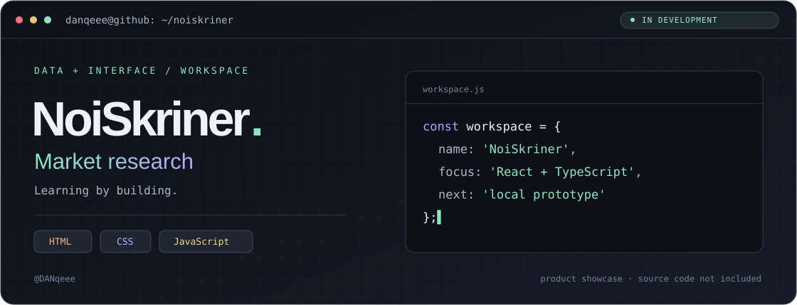
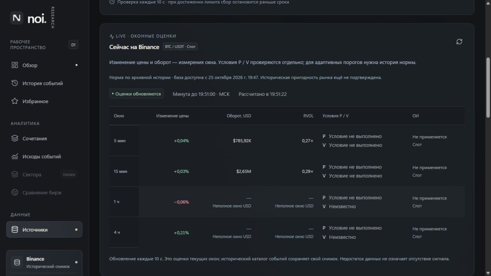

# NoiScreener

**Исследовательский workspace для наблюдения за криптовалютным рынком.**

Локальное веб-приложение для изучения рыночных событий, оконных изменений и качества исходных данных. Основной подключённый источник — публичные данные Binance. Исследовательский прототип в активной разработке.

> Этот репозиторий — публичная витрина. Здесь находятся описание и изображения интерфейса. Исходный код, наборы данных, внутренние методы и конфигурация не публикуются.

## Интерфейс

*Архивный снимок интерфейса от 25 октября 2026 года. На изображении — публичные рыночные данные, а не личный счёт. Снимок не отражает текущую ситуацию на рынке.*

## Что реализовано

- **Рабочее пространство:** таблицы наблюдений, каталог событий, фильтры и карточки с графиками.
- **Оконные оценки:** отдельное отображение цены, оборота и доступности открытого интереса; неизвестные значения не заменяются нулями.
- **История событий:** просмотр подтверждений и последующих исходов, сочетания условий и сохранение выбранного момента просмотра.
- **Состояния источников:** время актуальности, ошибки и пропуски данных, ограниченная живая таблица отдельно от исторического workspace.
- **Экспорт исследований:** JSON и архивы с метаданными и контрольными суммами.

## Фронтенд

**React · TypeScript · Vite · ECharts · CSS**

Плотные таблицы, графики, фильтры в URL, адаптивное представление, локальные настройки отображения, типизированная работа с API. Обновляемые таблицы учитывают устаревание и ошибки загрузки.

Серверная и исследовательская часть: Python, FastAPI, DuckDB, SQLite и Parquet. Интерфейс обращается к локальному API только для чтения.

## Проверки

Используются серверные и доменные тесты, фронтенд-тесты Vitest, проверка типов, сборка и браузерные проверки на большом и мобильном экранах. Поведение на отсутствующих данных и ошибки обновления проверяются отдельно.

## Ограничения

Часть экранов показывает зафиксированный исторический снимок, а не непрерывный live-поток. Полная пригодность исторических данных, нормализация открытого интереса и длительная эксплуатационная приёмка ещё не завершены. Приложение не является торговым роботом и не заявляет доказанного торгового преимущества. Публичная демонстрационная версия не развёрнута.

---

**[Профиль разработчика](https://github.com/DANqeee)** · **[Связаться](https://vk.com/levi23321)**
